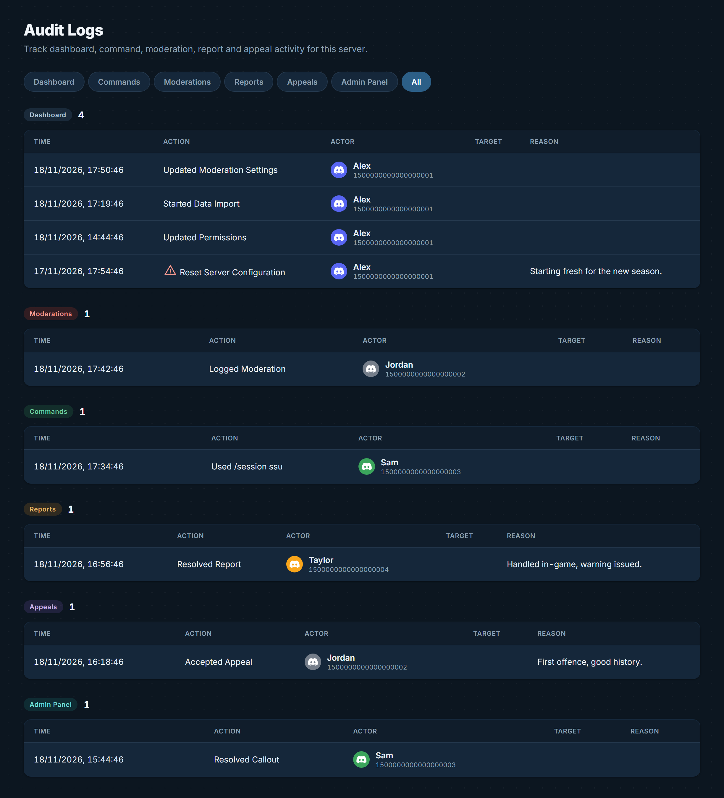

<Info>
  Viewing audit logs requires the **Audit Logs** permission.
</Info>

## Viewing Audit Logs

The **Audit Logs** page records activity in your server. Each entry shows the time, the category, the action, who did it and who it was done to, if anyone.

Use the tabs to filter entries by category.

**Dashboard**  Changes made on the dashboard. Dangerous actions are flagged.

**Commands**  Commands used in your server.

**Moderations**  Moderations that have been logged.

**Reports**  Actions taken on player reports.

**Appeals**  Actions taken on player appeals.

**Admin Panel**  Actions taken in the admin panel. These also appear in the **Tracking** tab on the admin panel itself.
