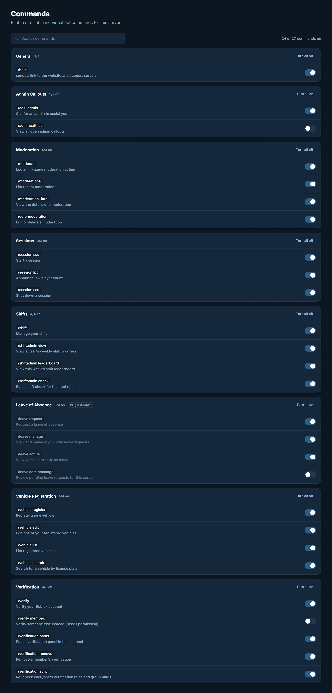

<Info>
  Managing commands requires the **Manage Commands** permission.
</Info>

## Managing Commands

The **Commands** page lists every command you can switch on or off, grouped by the plugin they belong to. A disabled command cannot be used by anyone in your server.

Each command and subcommand has its own switch, so you can turn off `/vehicle search` while keeping `/vehicle list` on, for example.

**Search**  Filter the list by a command's name or description.

**Turn all on / Turn all off**  Switches every command in a group at once. Each group also shows how many of its commands are on.

If a command's plugin is turned off in the **Plugins** menu, its group is marked as **Plugin disabled** and its commands cannot be used until the plugin is enabled again. Select the label to go to the **Plugins** page.

Changes are saved with the save bar at the bottom of the page.

## Command List

### General

| Command | What it does |
| --- | --- |
| `/help` | Sends a link to the website and support server. |

### Admin Callouts

| Command | What it does |
| --- | --- |
| `/call-admin` | Calls for an admin to assist you. |
| `/admincall list` | Shows all open admin callouts. |

### Moderation

| Command | What it does |
| --- | --- |
| `/moderate` | Logs an in-game moderation action. |
| `/moderations` | Lists recent moderations. |
| `/moderation-info` | Shows the details of a moderation. |
| `/edit-moderation` | Edits or deletes a moderation. |

### Sessions

| Command | What it does |
| --- | --- |
| `/session ssu` | Starts a session. |
| `/session lpc` | Announces a low player count. |
| `/session ssd` | Shuts down a session. |
| `/session transfer` | Hands the session to another member, adds a co-host or removes a co-host. |
| `/session poll` | Posts a session poll members can vote on. |

Turning off `/session poll` also stops the **Vote** and **Voters** buttons working on polls that are already posted.

### Shifts

| Command | What it does |
| --- | --- |
| `/shift` | Opens your shift panel to manage your shift. |
| `/shiftadmin view` | Shows a user's weekly shift progress. |
| `/shiftadmin leaderboard` | Shows this week's shift leaderboard. |
| `/shiftadmin check` | Runs a shift check for the mod role. |

### Leave of Absence

| Command | What it does |
| --- | --- |
| `/leave request` | Requests a leave of absence. |
| `/leave manage` | Shows and manages your own leave requests. |
| `/leave active` | Shows who is currently on leave. |
| `/leave adminmanage` | Reviews pending leave requests for the server. |

### Vehicle Registration

| Command | What it does |
| --- | --- |
| `/vehicle register` | Registers a new vehicle. |
| `/vehicle edit` | Edits one of your registered vehicles. |
| `/vehicle list` | Lists registered vehicles. |
| `/vehicle search` | Searches for a vehicle by license plate. |

### Verification

| Command | What it does |
| --- | --- |
| `/verify` | Verifies your Roblox account. |
| `/verify member:` | Verifies someone else instead. This needs the **Server Management** permission. |
| `/verification panel` | Posts a verification panel in the current channel. |
| `/verification remove` | Removes a member's verification. |
| `/verification sync` | Re-checks everyone's verification roles and group binds. |

`/verify` and `/verify member:` are the same command. The switch you use depends on whether the `member` option is filled in with someone else, so you can let members verify themselves while turning off verifying others.

<Note>
  `/language`, `/task view`, `/task resolve` and `/update` are not listed on the **Commands** page yet, so they can't be switched off. `/task` and `/update` still need the **Tasks** and **Verification** plugins enabled.
</Note>
