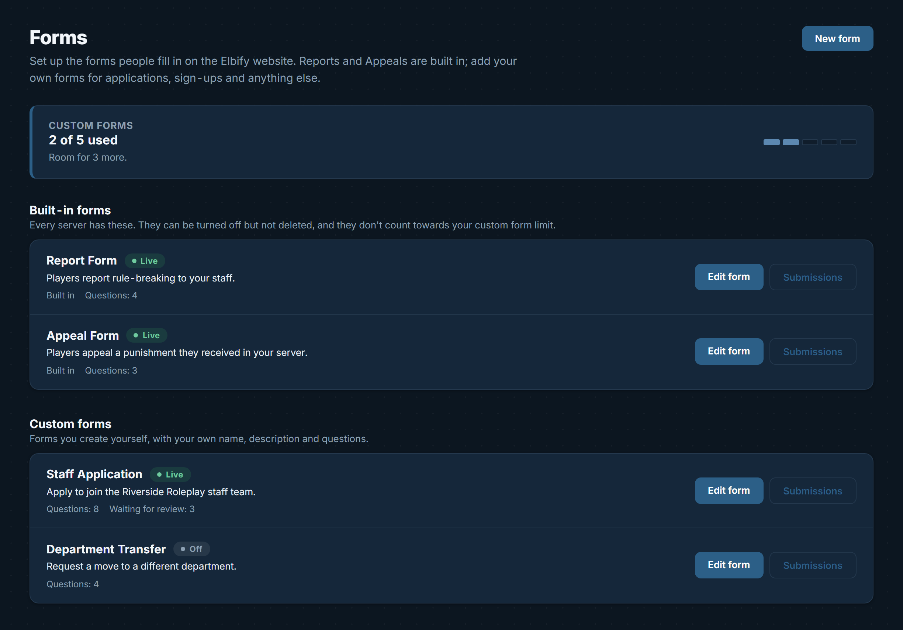
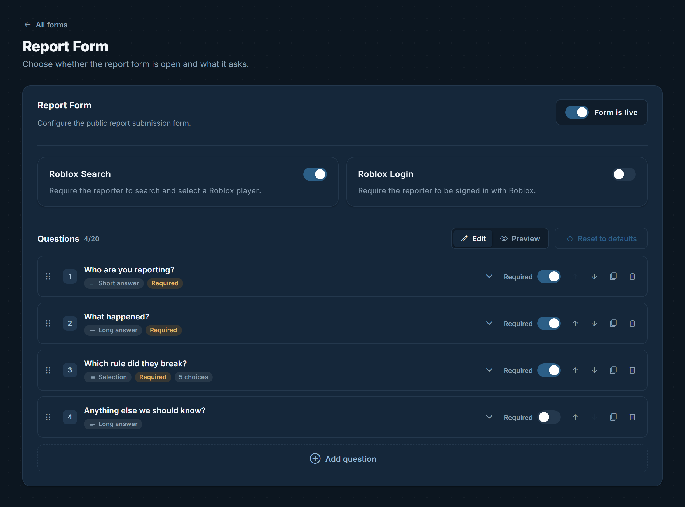

<Info>
  The report and appeal forms only work when their plugin is toggled **on** in the **Plugins** menu. See the Player Reports and Appeals pages for more information.
</Info>

## The Forms Page

The **Forms** page lists every form people can fill in for your server on the Elbify website. It has two groups.

**Built-in forms**  The **Report Form** and **Appeal Form**. Every server has these. They can be turned off but not deleted, and they don't count towards your custom form limit.

**Custom forms**  Forms you create yourself, with your own name, description and questions, such as staff applications or department transfers.

Each form shows whether it is **Live**, how many questions it has and how many submissions are waiting for review. Use **Edit form** to change it and **Submissions** to review what people have sent.

## Built-in Forms

The report and appeal forms have the same options.

**Form is live**  Makes the form available to players on the website. Players can't submit a form that isn't live.

**Roblox Search**  Requires the player to search for and select a Roblox player when submitting.

**Roblox Login**  Requires the player to be signed in with Roblox when submitting.

### Appealable Punishment Types

On the appeal form, choose which of your moderation types players are allowed to appeal. Players can only appeal moderations of these types, and the appeal form needs at least one selected to work.

### Questions

Each form shows the questions players will be asked, and whether each one is required. By default these are the standard Elbify questions, and you can reset them to the latest version at any time with **Reset to defaults**. Use **Preview** to see the form the way players will.

## Custom Forms

Select **New form** to create one. A new form stays hidden until you make it live. A server can have **1** custom form.

### Details

**Form name**  The name people see, for example "Staff application".

**Description**  Shown above the questions and in your server's list of forms.

**Confirmation message**  Shown after someone submits. Leave it blank to use the standard message.

### Access

**Form is live**  Shows the form on your server's forms page and accepts submissions.

**Roblox Login**  People must link their Roblox account first. Their Roblox ID is included with the submission.

**Attachments**  Lets people upload images with their answers.

**One submission at a time**  Someone can't submit again while their last submission is still waiting for review.

### Discord

**Submissions channel**  Where new submissions are posted. Without a channel, submissions only appear on the dashboard.

**Reviewer roles**  Members with these roles can accept or deny submissions with the buttons in Discord. Server admins always can. You can add up to **10** reviewer roles.

**Tell people the decision**  Sends the person a Discord direct message when their submission is accepted or denied.

### Roles on Decision

Give the person roles in your server when their submission is accepted, and separately when it is denied. A server can give **1** role for each. Elbify's role must be above these roles in your server settings.

### Questions

A form can have up to **20** questions. Each question can be a **Short answer**, a **Long answer** or a **Selection** from a list of choices, and can be required or optional.

Changes to a form apply to new submissions. Submissions already sent keep the questions they were answered with.

<Warning>
  **Important**

  If your server has more custom forms than its plan allows, for example after its limit is lowered, the newest forms are paused. They stay saved and you can still review their submissions, but nobody can fill them in until you delete forms or the limit goes up.
</Warning>
