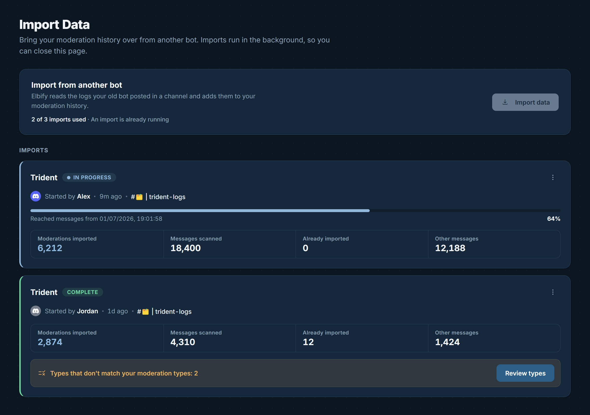
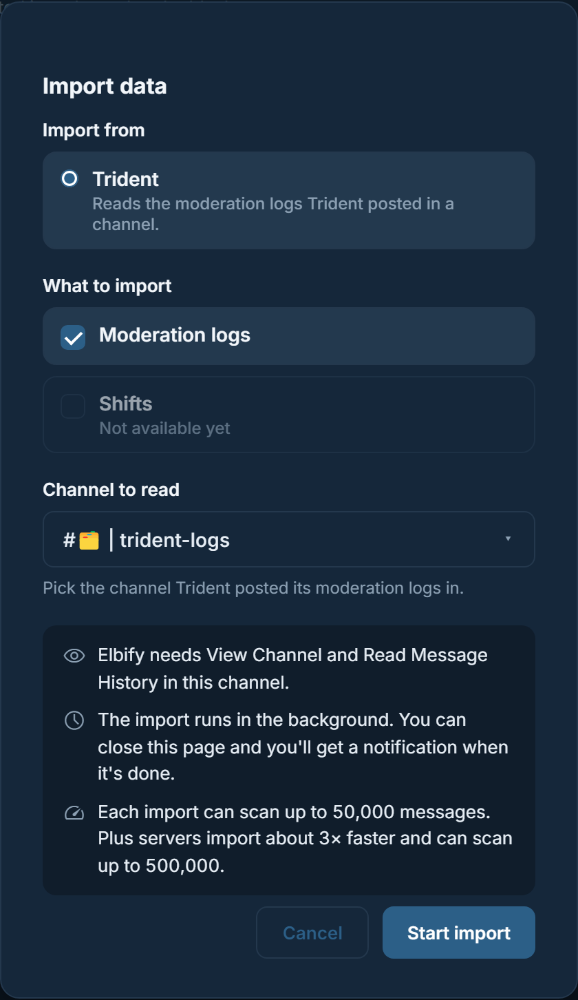
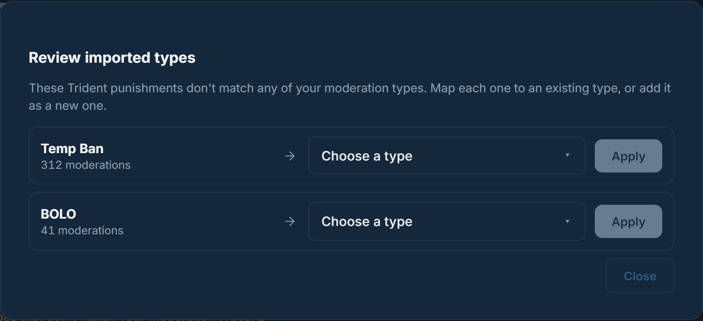

<Info>
  Importing data requires the **Administrator** permission.
</Info>

## How Imports Work

If your server used Trident before, Elbify can read the moderation logs Trident posted in a channel and add them to your moderation history. Imported moderations show up on the admin panel and in `/moderations` like any other.

Imports run in the background. You can close the page while an import runs, and you'll get a notification when it finishes.

## Starting an Import

1. Select **Import data**.
2. Choose **Trident** and **Moderation logs**.
3. Pick the channel Trident posted its moderation logs in.
4. Select **Start import** and confirm.

<Warning>
  **Important**

  Elbify needs the **View Channel** and **Read Message History** permissions in the channel you pick. Missing permissions are the most common reason an import fails.
</Warning>

Importing shifts from Trident isn't available yet.

## Tracking an Import

Each import shows who started it, when, which channel it reads, and its status.

| Status | Meaning |
| --- | --- |
| In queue | Waiting for a free slot. It starts automatically. |
| In progress | Reading the channel. A progress bar shows how far through the channel's history it is. |
| Complete | Finished. |
| Failed | Stopped because of a problem, such as missing permissions. The reason is shown on the import. |
| Cancelled | Stopped by an admin. Everything it imported was removed. |
| Data deleted | An admin deleted the moderations it imported. |

**Moderations imported**  Trident moderation logs added to your history.

**Messages scanned**  Every message read from the channel so far.

**Already imported**  Logs skipped because an earlier import already brought them in. You can import the same channel again without creating duplicates.

**Other messages**  Messages in the channel that aren't Trident moderation logs.

## Moderation Types

Elbify matches each Trident punishment to your [moderation types](/pages/plugins/moderation), ignoring capitals, spaces and punctuation, so "warning" becomes your "Warning".

If some punishments don't match any of your types, the import shows **Review types**. For each one, either map it to one of your existing types or add it as a new type. Mapping updates every moderation from that import at once.

## Cancelling and Deleting

Use the menu on an import to manage it.

**Cancel import**  Stops an import that's still running and removes everything it already brought in.

**Delete imported data**  Removes the moderations a finished import brought in. Your other moderations aren't affected.

## Limits

- Only one import can run at a time in a server.
- A server can start **3** imports, or **10** with Elbify Plus. Cancelled and failed imports count too.
- Each import can scan up to **50,000** messages. With Elbify Plus, imports run about 3 times faster and can scan up to **500,000** messages.
