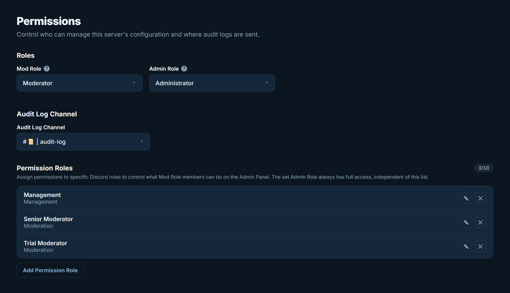
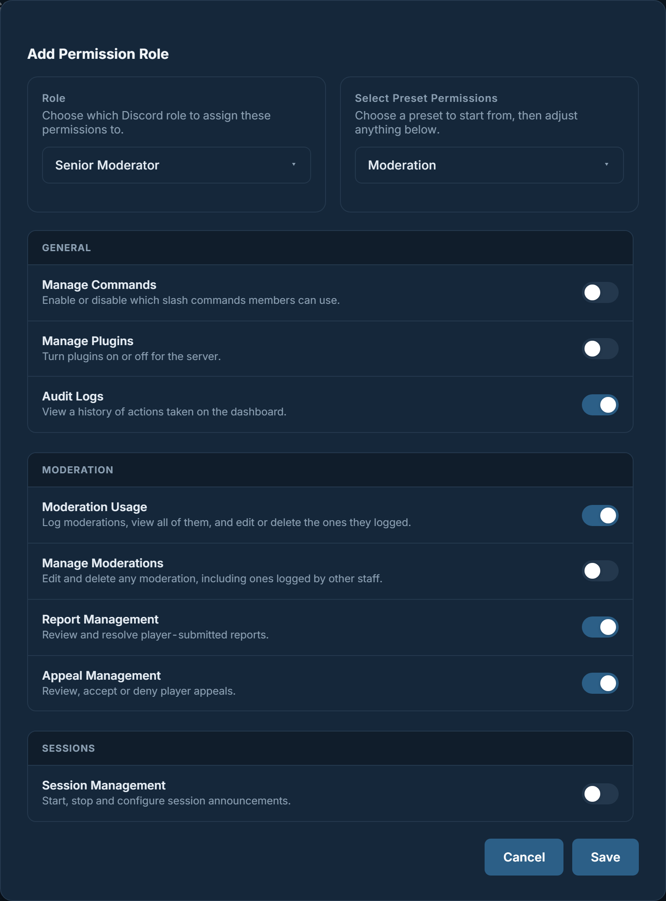

<Info>
  Setting up permissions is required before your staff can use the admin panel. Until a mod role, admin role or permission role is set, the admin panel will ask an administrator to configure them.
</Info>

## Roles

**Mod Role**  Members with this role can access the admin panel. Individual permissions must still be set in order to use certain features on the panel.

**Admin Role**  Members with this role get full dashboard access, except for Danger Zone actions, regardless of their Discord server permissions.

## Permission Roles

Permission roles assign permissions to specific Discord roles, which controls what mod role members can do. The admin role always has full access, independent of this list. You can add up to **10** permission roles.

When adding a permission role, choose the Discord role and then select a preset to start from. You can adjust any permission afterwards.

**Guest**  No permissions.

**Moderation**  Logging moderations, handling reports and appeals, `/whois` lookups, shifts, leave requests and audit logs.

**Administration** and **Management**  Full access to the staff features, including managing commands, plugins and the server.

## Permission Keys

Permissions are grouped the same way as in the **Add Permission Role** window.

| Permission | What it allows |
| --- | --- |
| **General** |  |
| Manage Commands | Enable or disable which slash commands members can use. |
| Manage Plugins | Turn plugins on or off for the server. |
| Audit Logs | View a history of actions taken on the dashboard. |
| **Moderation** |  |
| Moderation Usage | Log moderations, view all of them, and edit or delete the ones they logged. |
| Manage Moderations | Edit and delete any moderation, including ones logged by other staff. |
| Report Management | Review and resolve player-submitted reports. |
| Appeal Management | Review, accept or deny player appeals. |
| **Lookup** |  |
| Use /whois | Look up players' linked Roblox and Discord accounts. Admins, the server owner, members with the mod role and members with Discord's **Moderate Members** permission already have it. |
| **Sessions** |  |
| Session Management | Start, end and announce sessions, post session polls, see poll voters, and be made a session host or co-host. |
| **Shifts & Tasks** |  |
| Shift Usage | Start, stop, and put your own shift on break. |
| Shift Management | Force stop and manage other members' shifts. |
| Shift Type Management | Create, edit, delete and view shift types. |
| Task Management | Create, edit, delete and view duty tasks. |
| **Leave of Absence** |  |
| Leave of Absence Usage | Request a leave of absence. |
| Leave of Absence Management | Review, accept or deny leave of absence requests. |
| **Vehicle Registration** |  |
| Vehicle Search | Search registered vehicles by license plate and view player details. |
| Vehicle Registration Management | Configure vehicle registration settings on the dashboard. |
| **Access** |  |
| Server Management | Can configure the bot, including the Moderation, Admin Callouts and Verification settings. Excludes Danger Zone actions. |
| Administrator | Can do everything, including Danger Zone actions. |
