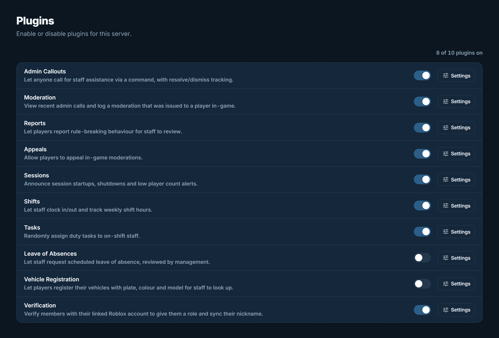

<Info>
  Managing plugins requires the **Manage Plugins** permission.
</Info>

## Managing Plugins

Each Elbify feature is a plugin. A plugin's commands, settings and admin panel tabs only work while the plugin is turned on.

The **Plugins** page lists every plugin with a short description and a switch. The count at the top shows how many plugins are on. Select **Settings** next to a plugin to go straight to its settings page.

Changes are saved with the save bar at the bottom of the page.

| Plugin | What it does |
| --- | --- |
| [Admin Callouts](/pages/plugins/admin-callouts) | Lets anyone call for staff assistance with a command, with resolve and dismiss tracking. |
| [Moderation](/pages/plugins/moderation) | Logs the moderations issued to players in-game. |
| [Reports](/pages/plugins/player-reports) | Lets players report rule-breaking behaviour for staff to review. |
| [Appeals](/pages/plugins/appeals) | Lets players appeal in-game moderations. |
| [Sessions](/pages/plugins/session-management) | Announces session startups, shutdowns and low player count alerts. |
| [Shifts](/pages/plugins/shifts) | Lets staff clock in and out and tracks weekly shift hours. |
| [Tasks](/pages/plugins/tasks) | Randomly assigns duty tasks to on-shift staff. |
| [Leave of Absences](/pages/plugins/leave-of-absence) | Lets staff request scheduled leave, reviewed by management. |
| [Vehicle Registration](/pages/plugins/vehicle-registration) | Lets players register their vehicles for staff to look up. |
| [Verification](/pages/plugins/verification) | Verifies members with their linked Roblox account to give them roles and sync their nickname. |

Turning a plugin off doesn't delete its settings or data. They are kept and used again when you turn it back on.

Individual commands can also be switched off on the [**Commands**](/pages/dashboard/commands) page.
