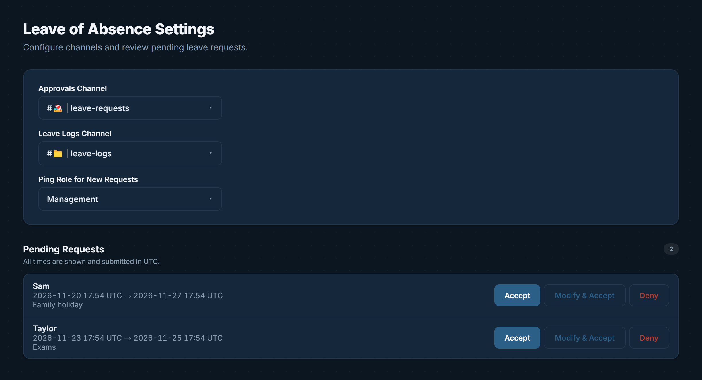

<Info>
  Before reading, please toggle the "Leave of Absences" plugin **on** in the **Plugins** menu on the dashboard.
</Info>

## Requesting Leave

Staff with the **Leave of Absence Usage** permission can request leave with the `/leave request` command.

{/* IMAGE: /images/leaverequestexample.png - screenshot of the /leave request command with the start, end and reason options visible */}

**start**  When your leave begins, in the format `YYYY-MM-DD HH:mm`. This must be in the future.

**end**  When your leave ends, in the same format. This must be after the start.

**reason**  The reason for your leave. This is optional.

<Warning>
  **Important**

  All dates and times are in **UTC**.
</Warning>

---

Once the parameters have been filled out, send the command and confirm your request. It is then sent to management for review, and you will be messaged when it is accepted or denied.

You can check your own requests with `/leave manage`, which also lets you cancel a request that is still pending. To see who is currently on leave, use `/leave active`.

## Reviewing Requests

Staff with the **Leave of Absence Management** permission can review pending requests with `/leave adminmanage`, from the approvals channel, or from the **Leave of Absence Settings** page on the dashboard.

**Accept**  Approves the request as submitted.

**Modify & Accept**  Approves the request with different start and end dates.

**Deny**  Denies the request. You can optionally give a reason.

{/* IMAGE: /images/leavereviewexample.png - screenshot of a leave request in the approvals channel with the Accept, Modify & Accept and Deny buttons */}

## Configuring the Plugin

The leave settings are found on the **Leave of Absence Settings** page of the dashboard.

**Approvals Channel**  The channel new leave requests are sent to for review.

**Leave Logs Channel**  The channel the outcome of each request is logged to.

**Ping Role for New Requests**  The role pinged when a new request is sent to the approvals channel.

If the "Shifts" plugin is enabled, accepted leave can also excuse staff from the weekly shift requirement. See the Shifts page for more information.
