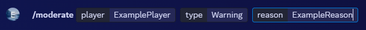
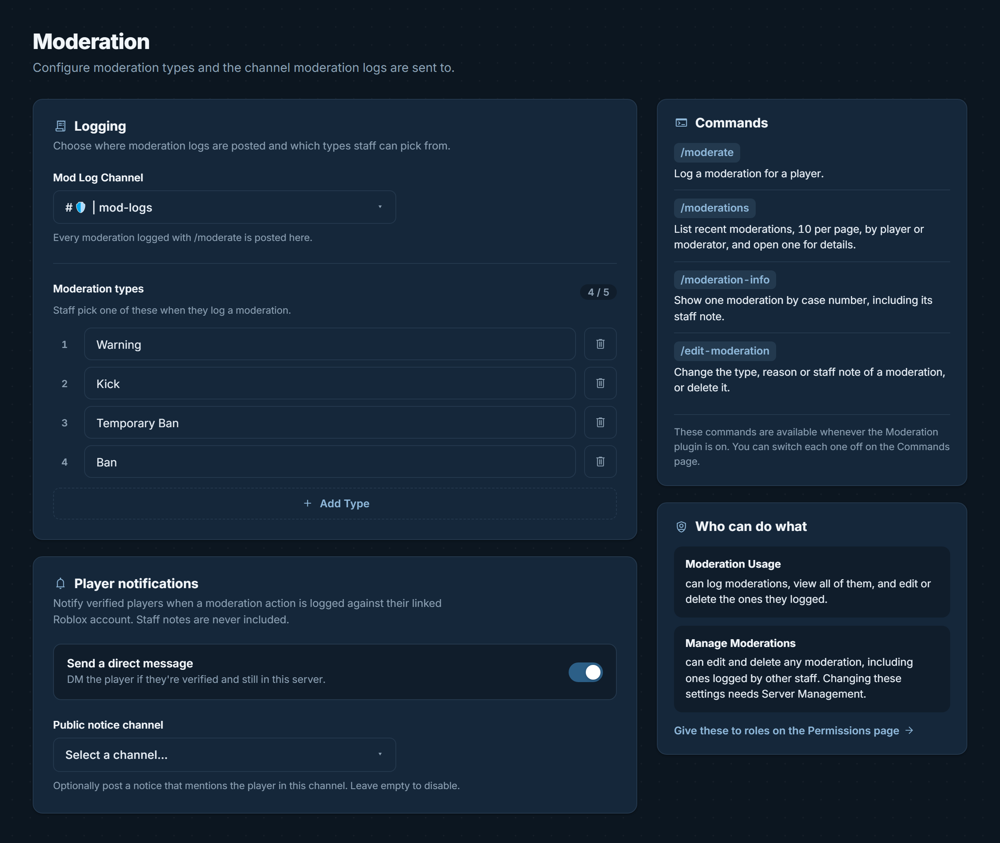

<Info>
  Before logging moderations, please toggle the "Moderation" plugin **on** in the **Plugins** menu on the dashboard.
</Info>

## Logging Moderations

Logging / creating moderations is very simple. There are **two** ways to log moderations; the dashboard admin panel or with the `/moderate` command.

**player**  The Roblox username of the player you are moderating. Select them from the list that appears as you type.

**type**  The punishment type, either from the defaults or customised options in the dashboard.

**reason**  The reason for punishing the player, for example: RDM, FRP, etc.

---

On the **admin panel**, if the **Moderation Usage** permission is set on the [**Permissions**](/pages/dashboard/permissions) page of the dashboard, your server staff will be able to log moderations directly.  To do this, you should **enter the username of the player** and select the correct player from the dropdown menu. Add the reason and select the punishment type, then click `Log Moderation`.

---

Once the parameters have been filled out, simply send the command. If the plugin is enabled, you will be asked to confirm or cancel the moderation. Check the information is correct and confirm it; the moderation will be logged as a numbered case and visible on the admin panel. If a moderation log channel is set, the case is also posted there.

Only the moderator who ran the command can confirm it, and the confirmation expires after **5 minutes**.

---

## Viewing and Editing Moderations

**/moderations**  Lists recent moderations, 10 per page. Filter by player or moderator, and open one for its details.

**/moderation-info**  Shows one moderation by its case number, including its staff note.

**/edit-moderation**  Changes the type, reason or staff note of a moderation, or deletes it.

Staff with **Moderation Usage** can view every moderation, but only edit or delete the ones they logged. Staff with **Manage Moderations** can edit and delete any moderation. Moderations can also be viewed and edited from the **Moderation** tab on the admin panel.

Each of these commands can be switched off on the [**Commands**](/pages/dashboard/commands) page.

---

## Configuring the Plugin

The moderation settings are found on the **Moderation** page of the dashboard, which requires the **Server Management** permission.

**Mod Log Channel**  The channel confirmed moderations are posted to.

**Moderation Types**  The punishment types that can be chosen when logging a moderation. You can add up to **5** types, or **25** with Elbify Plus. These are also the types you can allow players to appeal in the [Forms](/pages/dashboard/forms) settings.

### Player Notifications

Elbify can tell players when a moderation is logged against their linked Roblox account. Staff notes are never included.

**Send a direct message**  DMs the player if they're verified and still in your server.

**Public notice channel**  Optional. Posts a notice that mentions the player in this channel. Leave it empty to disable.

## Importing From Another Bot

If you used Trident before, you can bring its moderation logs over with the [**Import Data**](/pages/dashboard/import-data) page.
