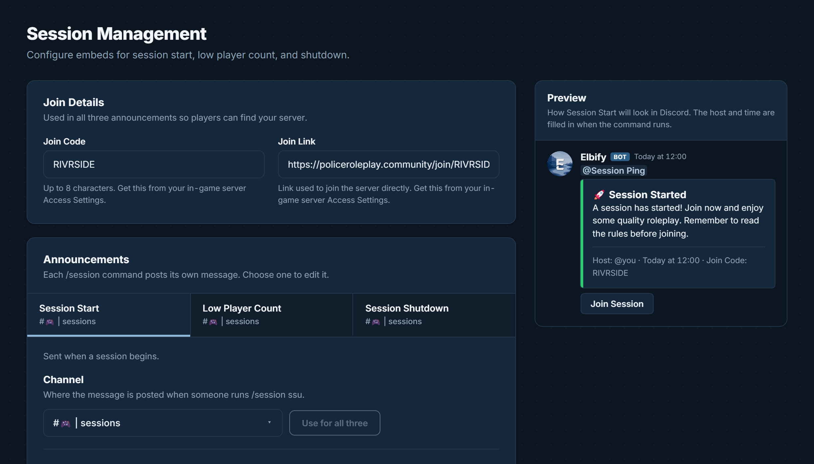
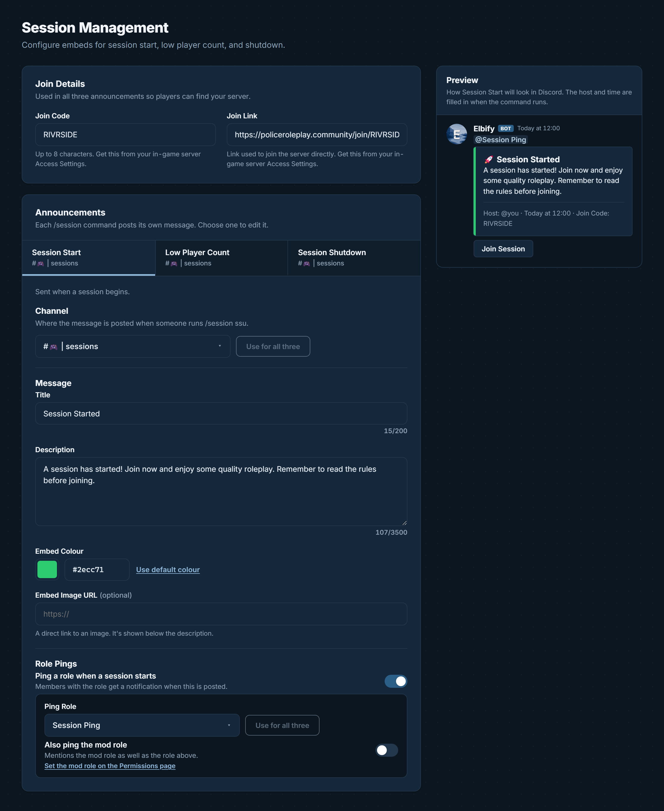

<Info>
  Before reading, please toggle the "Sessions" plugin **on** in the **Plugins** menu on the dashboard.
</Info>

## Announcing a Session

Staff with the **Session Management** permission can announce a session with the `/session` command.

{/* IMAGE: /images/sessioncmdexample.png - screenshot of the /session command showing the ssu, lpc and ssd subcommands */}

**ssu**  Announces that a session has started.

**lpc**  Announces a low player count.

**ssd**  Announces that the session has ended.

---

The announcement is sent to the channel set for that type on the dashboard, showing who the host is, the time, and the join code if one is set. If a join link is set, a **Join Session** button is added.

{/* IMAGE: /images/sessionannouncementexample.png - screenshot of a session start announcement in the announcements channel */}

<Info>
  If no channel has been set for an announcement type, the command will tell you to set one in the dashboard.
</Info>

## Configuring the Plugin

The session settings are found on the **Session Management** page of the dashboard.

**Join Code**  Up to 8 characters. You can get this from your ingame server's Access Settings.

**Join Link**  The link used to join the server directly. You can also get this from your ingame server's Access Settings.

### Announcement Types

**Session Start**, **Low Player Count** and **Session Shutdown** are each configured separately. Select one to edit it; a preview of the announcement is shown as you make changes.

**Channel**  The channel the announcement is sent to.

**Embed Colour**  The accent colour of the announcement.

**Embed Title**  The title of the announcement, up to 200 characters.

**Description**  The body of the announcement, up to 3500 characters.

**Embed Image URL**  An optional image shown in the announcement.

**Role Pings**  Optionally ping a role when the announcement is sent. You can also choose to ping the mod role.

To set the same channel or ping role on all three announcement types at once, use the **Apply To All** options at the top of the page.
