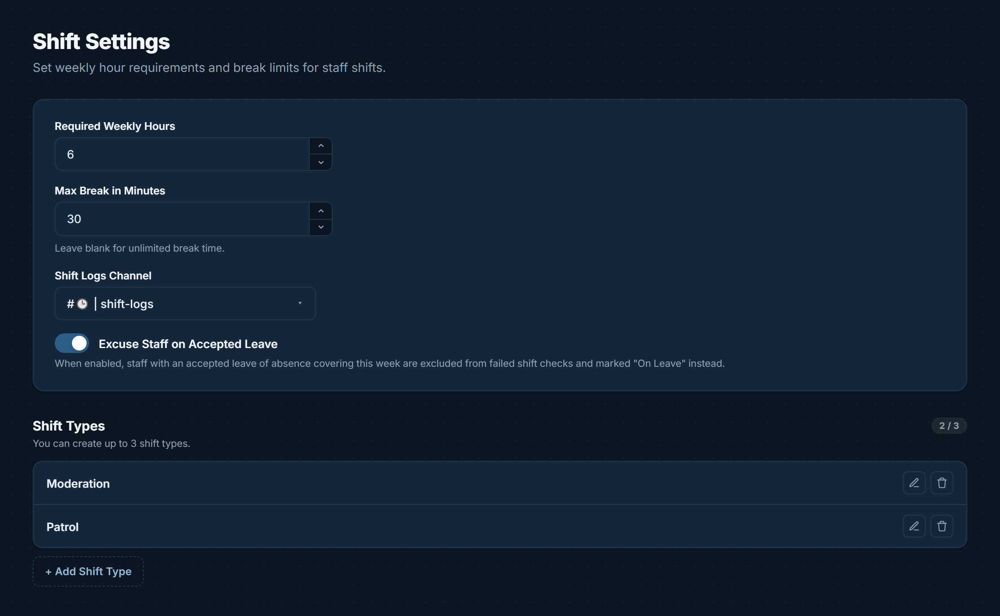
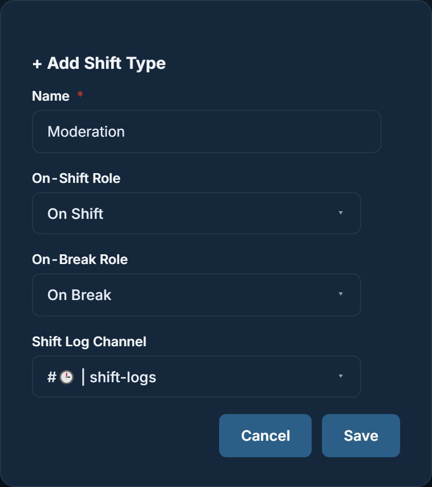

<Info>
  Before reading, please toggle the "Shifts" plugin **on** in the **Plugins** menu on the dashboard.
</Info>

## Managing Your Shift

Staff with the **Shift Usage** permission can start and manage their own shift with the `/shift` command. This opens your shift panel.

{/* IMAGE: /images/shiftpanelexample.png - screenshot of the /shift panel before a shift is started */}

Press **Start** to clock in. If your server has more than one shift type, pick the one you want to start. While your shift is running you can put it on break, resume it, or end it from the same panel.

{/* IMAGE: /images/shiftactiveexample.png - screenshot of the shift panel while a shift is active */}

If the shift type has an **on-shift role** or an **on-break role** set, Elbify gives and removes these for you as your shift changes. When you end your shift, a summary is sent to the shift type's log channel.

The shift panel can only be used by the staff member it belongs to.

---

## Reviewing Shifts

Staff with the **Shift Management** permission can review shifts with the `/shiftadmin` command.

**view**  Shows how much a staff member has completed this week compared to the weekly requirement.

**leaderboard**  Shows this week's shift leaderboard.

**check**  Checks every member with the mod role against the weekly requirement and lists who passed, failed or was excused.

The **Shifts** tab on the admin panel shows the staff who are currently on shift.

## Configuring the Plugin

The shift settings are found on the **Shift Settings** page of the dashboard.

**Required Weekly Hours**  The number of hours staff need to complete each week.

**Max Break in Minutes**  The longest a break can last. Leave it blank for unlimited break time.

**Shift Logs Channel**  The channel shift activity is logged to.

**Excuse Staff on Accepted Leave**  When enabled, staff with an accepted leave of absence covering this week are marked as "On Leave" instead of failing a shift check.

### Shift Types

Shift types let you run different kinds of shifts in your server. A server can have up to **3** shift types by default. Creating, editing and deleting them requires the **Shift Type Management** permission.

**Name**  The name of the shift type, up to 30 characters.

**On-Shift Role**  The role given while a staff member is on shift.

**On-Break Role**  The role given while a staff member is on break.

**Shift Log Channel**  The channel a summary is sent to when a shift of this type ends.

