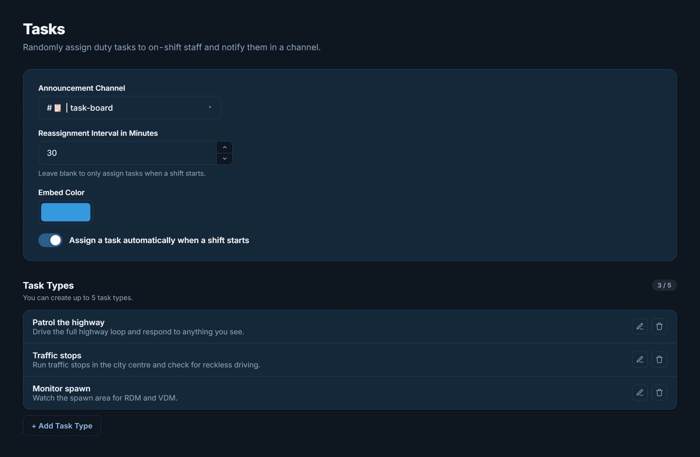
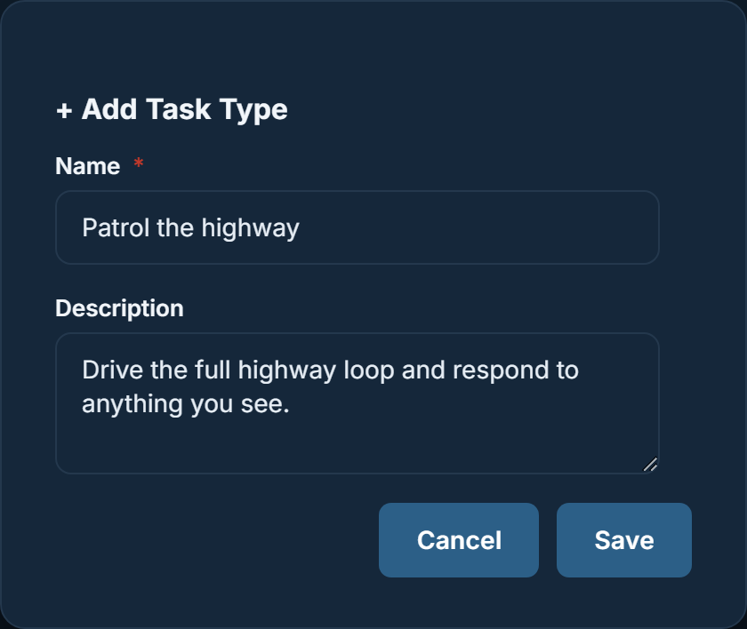

<Info>
  Before reading, please toggle the "Tasks" plugin **on** in the **Plugins** menu on the dashboard.

  **Tasks are assigned to staff who are on shift, so the "Shifts" plugin should also be enabled for this plugin to work as intended.**
</Info>

## How Tasks Work

When a task is assigned, Elbify picks one of your task types at random and gives it to the staff member. A new task replaces the one they had before.

Tasks are assigned in two ways, both of which can be controlled in the settings:

- Automatically when a staff member starts a shift.
- On a repeating interval, for every staff member currently on shift.

If an announcement channel is set, the task is posted there and the staff member is pinged.

{/* IMAGE: /images/taskannouncementexample.png - screenshot of a task announcement in the announcement channel */}

Staff with the **Task Management** permission can see the active tasks of your staff team in the **Tasks** tab on the admin panel.

## Resolving Your Task

Once you have completed your task, resolve it in one of three ways:

- Press **Resolve Task** on the task announcement.
- Use `/task resolve`.
- Select **Resolve Task** on the **Overview** tab of the admin panel.

Only the staff member the task is assigned to can resolve it. If you are still on shift, you are given a new task straight away, which won't be the same task you just resolved.

Use `/task view` to see your current task, its description and when it was assigned.

**Breaks**  Your task is paused while you are on break, and can't be resolved until you end your break.

**Ending your shift**  When you end your shift, or leave the server, your task is released.

## Configuring the Plugin

The task settings are found on the **Tasks** page of the dashboard, which requires the **Task Management** permission.

**Announcement Channel**  The channel task assignments are posted to.

**Reassignment Interval in Minutes**  How often staff on shift are given a new task. Leave this blank to only assign tasks when a shift starts.

**Embed Colour**  The colour of the task announcement.

**Assign a task automatically when a shift starts**  Gives staff a task as soon as they start a shift.

### Task Types

Task types are the duties that can be assigned. A server can have up to **5** task types by default.

**Name**  The name of the task, up to 30 characters.

**Description**  An optional description of what the task involves, up to 200 characters. It is shown in the announcement.

