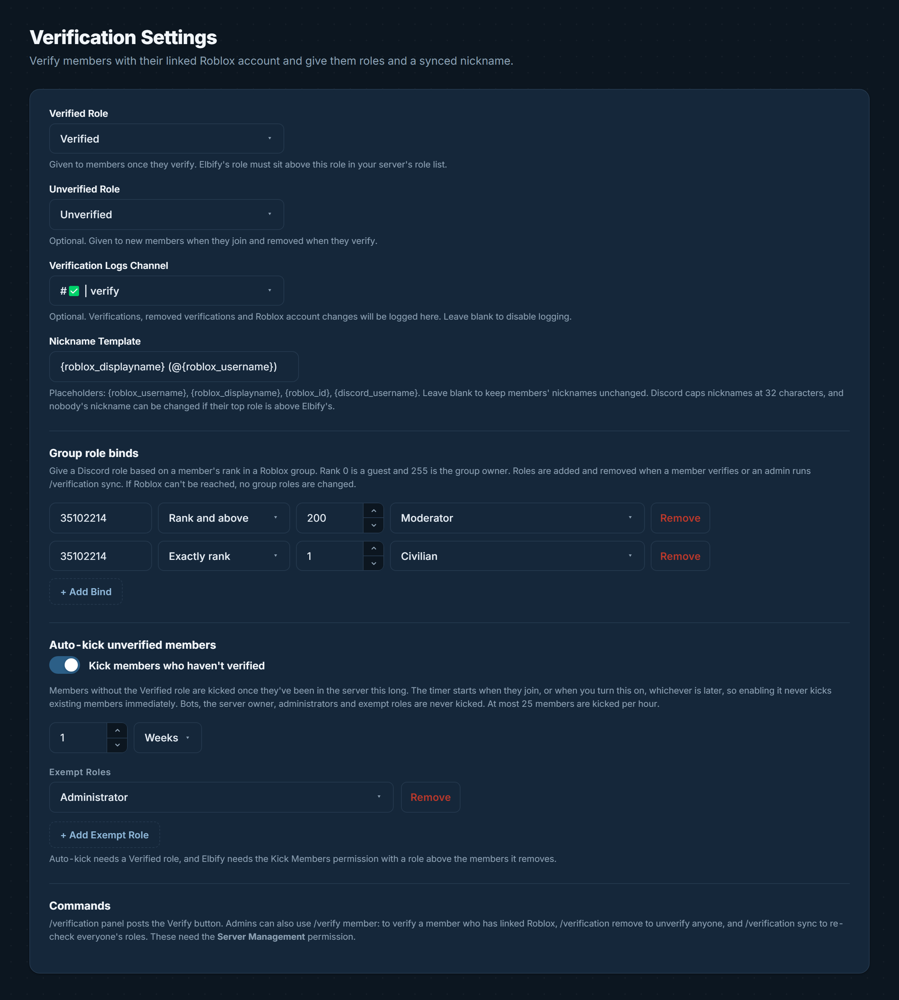

<Info>
  Before reading, please toggle the "Verification" plugin **on** in the **Plugins** menu on the dashboard.

  **A Verified role must be set on the dashboard, and Elbify's role must sit above it in your server's role list, in order for this plugin to work as intended.**
</Info>

## Verifying Members

Members can verify themselves with the **Verify** button on the verification panel, or with `/verify`. If they have already linked their Roblox account on Elbify they are verified instantly, otherwise they are asked to link it first.

Once verified, a member is given the Verified role and their nickname is updated using the nickname template.

{/* IMAGE: /images/verifypanelexample.png - screenshot of the verification panel with the Verify button */}

## Finding Players with /whois

The Roblox account a member links to Elbify also powers `/whois`, which works whether or not this plugin is on.

**/whois roblox**  Takes a Roblox username or ID and shows whether that player is in this Discord server, with their Roblox username, Roblox ID and linked Discord account.

**/whois discord**  Shows the Roblox account linked to a Discord member.

A player who has linked once can be found in every server that uses Elbify, so staff don't need to ask players in-game whether they're in the Discord. That makes it a good reason to point players to verification. Linked accounts are only shown when the person is in that Discord server.

Using `/whois` needs the **Use /whois** permission on the [**Permissions**](/pages/dashboard/permissions) page.

## Managing Verification

These commands require the **Server Management** permission.

**/verify member:**  Verifies someone else who has linked their Roblox account. This is the same `/verify` command with the `member` option filled in.

**/verification panel**  Posts the verification panel in the current channel. Attach an image with the `image` option to show it on this panel instead of the dashboard's panel image. It must be a PNG, JPG, GIF or WEBP file of 8MB or less, and Elbify needs the **Attach Files** permission in the channel.

**/verification remove**  Removes a member's verification.

**/verification sync**  Re-checks every verified member's roles and group binds. This runs in the background and you will be told when it finishes.

**/update**  Updates a member's verification roles and nickname.

Each of these can be switched off on the [**Commands**](/pages/dashboard/commands) page. `/verify` and `/verify member:` have separate switches, so you can let members verify themselves while turning off verifying others.

## Configuring the Plugin

The verification settings are found on the **Verification Settings** page of the dashboard.

**Verified Role**  Given to members once they verify.

**Unverified Role**  Optional. Given to new members when they join and removed when they verify.

**Verification Logs Channel**  Optional. Verifications, removed verifications and Roblox account changes are logged here. Leave it blank to disable logging.

**Panel Image**  Optional. An image shown on verification panels posted with `/verification panel`. Upload a PNG, JPG, GIF or WEBP file of up to 4MB. It is saved as soon as you upload or remove it. Panels that are already posted keep their old image, so post a new panel to show the change.

**Nickname Template**  Sets members' nicknames when they verify. You can use `{roblox_username}`, `{roblox_displayname}`, `{roblox_id}` and `{discord_username}`. Leave it blank to keep nicknames unchanged.

<Info>
  Discord caps nicknames at 32 characters, and nobody's nickname can be changed if their top role is above Elbify's.
</Info>

### Group Role Binds

Group role binds give a Discord role based on a member's rank in a Roblox group. Rank 0 is a guest and 255 is the group owner. You can add up to **25** binds.

**Group ID**  The ID of the Roblox group.

**Mode**  Either **Rank and above** or **Exactly rank**.

**Rank**  The group rank to match.

**Role**  The Discord role given to members who match.

Roles are added and removed when a member verifies or when `/verification sync` is run. If Roblox can't be reached, no group roles are changed.

### Auto-kick

Auto-kick removes members who haven't verified after a set amount of time, from 1 day to 365 days.

The timer starts when a member joins, or when you turn auto-kick on, whichever is later, so enabling it never kicks existing members immediately. Bots, the server owner, administrators and members with an **exempt role** are never kicked. You can add up to **10** exempt roles. At most **25** members are kicked per hour.

<Warning>
  **Important**

  Auto-kick needs a Verified role set, and Elbify needs the **Kick Members** permission with a role above the members it removes.
</Warning>
